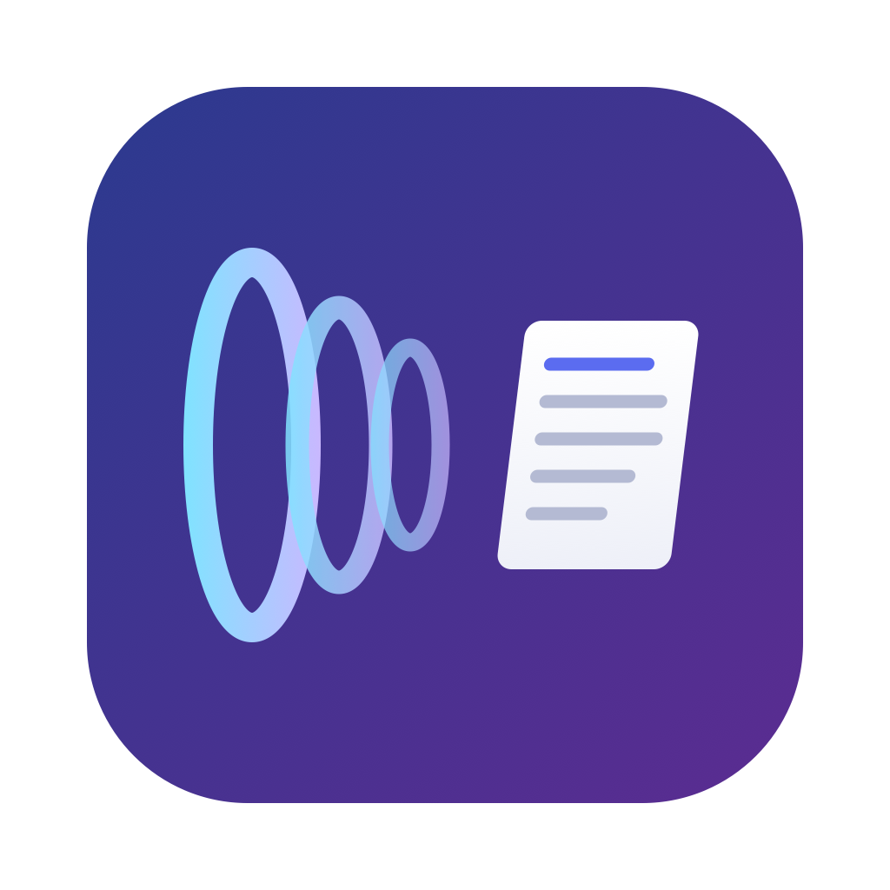

<div align="center">



# WaveScribe

**Local speech-to-text for the Mac**

Press a shortcut, speak, and the text appears at your cursor. Recognition runs entirely on your Mac: free, open source, light on memory and quick to respond.

[](../../releases/latest)


[](LICENSE)

[中文](README.md) · **English**

</div>

WaveScribe is a menu bar dictation tool for macOS. It was built and tuned mainly for Mandarin and mixed Chinese-English speech. It also handles everyday English well: we have used it for English and it works without problems, though we have not tested English as thoroughly as Chinese.

**For English, switch to the Whisper model** (see [Use it for English](#use-it-for-english) below).

- **Simple**: download, drag to Applications, grant two permissions, done.
- **Fast**: transcribes while you speak, so text usually appears 1 to 2 seconds after you stop.
- **Light**: the model loads only when you use it and is released after 1 minute idle.

## Install

**Requirements**: a Mac with Apple Silicon (M series), macOS 15 or later.

1. Download the latest `WaveScribe.zip` from [Releases](../../releases), unzip it and drag WaveScribe into Applications.
2. Open WaveScribe. It has no Dock icon; look for the microphone icon in the menu bar.
3. Grant two permissions when asked:
   - **Microphone**: to record your voice.
   - **Accessibility**: to type the text at your cursor and to detect a single-key shortcut such as ⌥ on its own. WaveScribe uses it only for these two things, and all the code is in this repository. Without it, shortcuts such as ⌥ Space still work, but the text appears in a small window for you to copy. If no prompt appears, turn WaveScribe on under System Settings → Privacy & Security → Accessibility.
4. On first launch it downloads the default model (about 750 MB). The menu bar icon shows the progress.

**Updates**: WaveScribe checks for updates once a day and offers to install them with one click. You can also choose Check for Updates… from the menu bar icon.

**Uninstall**: delete WaveScribe from Applications, then delete `~/Library/Application Support/WaveScribe` (models and history).

## Use it for English

1. Click the menu bar icon and choose **Preferences…**.
2. Under **Recognition model**, select **Whisper (English only)**.
3. WaveScribe downloads Whisper large-v3 turbo (about 1.5 GB) the first time. After that it works offline.

Whisper is slower than the default model: text appears about 2.5 to 3.5 seconds after you stop. If you mostly speak Chinese, or Chinese mixed with English words, keep the default **Qwen**.

## Everyday use

- Press **⌥ Space** in any text field to start, press it again to stop. Press Esc to cancel.
- **Preferences…** has:
  - **Shortcut**: any key combination, or a single modifier key (⌃ ⌥ ⇧ ⌘) pressed on its own.
  - Trigger mode: press to start and press again to stop, or hold to talk.
  - **Recognition model**: Qwen for Chinese and mixed speech, Whisper for English.
  - **Keep recordings**: keep only recordings you corrected (default), keep all, or delete everything after 24 hours.
  - The wooden fish animation shown while transcribing; untick it for a plain spinner.
  - **Recording indicator position**: any cell of a 3 × 3 grid; bottom center by default.
  - **Language**: follows your system language by default; can be set to Chinese or English.
- **Open Window** shows the last 24 hours of dictations, which you can edit. Your corrections turn into suggestions for the vocabulary list (`vocabulary.txt`) and replacement rules (`rules.json`).

## Compared with commercial tools

Commercial dictation tools such as Wispr Flow do this very well: accurate, fast, with many extras such as rewriting and formatting. WaveScribe does the same core job in a leaner way: speak, and get fast, accurate text. It is free, open source, runs on your Mac and uses little memory.

## Privacy

- Recording, recognition and post-processing all happen on your Mac. It goes online only to download models (Hugging Face, GitHub) and to check for updates.
- History, recordings, vocabulary and rules are in `~/Library/Application Support/WaveScribe/Data`; models in `~/Library/Application Support/WaveScribe/models`.

## Build from source

You need Xcode 16 or later and the Metal compiler:

```sh
xcodebuild -downloadComponent MetalToolchain   # once, about 800 MB
./build.sh            # builds and signs WaveScribe.app in this folder
./build.sh install    # also copies it to Applications and opens it
```

More detail (in Chinese) is in the [Chinese README](README.md) and the [experiment notes](docs/实验记录.md), which compare the speech models we tried and explain how the app keeps memory low.

## Credits

[Qwen3-ASR](https://github.com/QwenLM) (Alibaba Qwen team), [speech-swift](https://github.com/soniqo/speech-swift), [MLX Swift](https://github.com/ml-explore/mlx-swift), [WhisperKit](https://github.com/argmaxinc/WhisperKit), [FluidAudio](https://github.com/FluidInference/FluidAudio), [sherpa-onnx](https://github.com/k2-fsa/sherpa-onnx), [Sparkle](https://github.com/sparkle-project/Sparkle) and the CT-Transformer punctuation model from [FunASR](https://github.com/modelscope/FunASR). Each has its own license; see the [Chinese README](README.md#致谢) for details.

## License

[MIT](LICENSE) © 2026 ZJ-Gao
