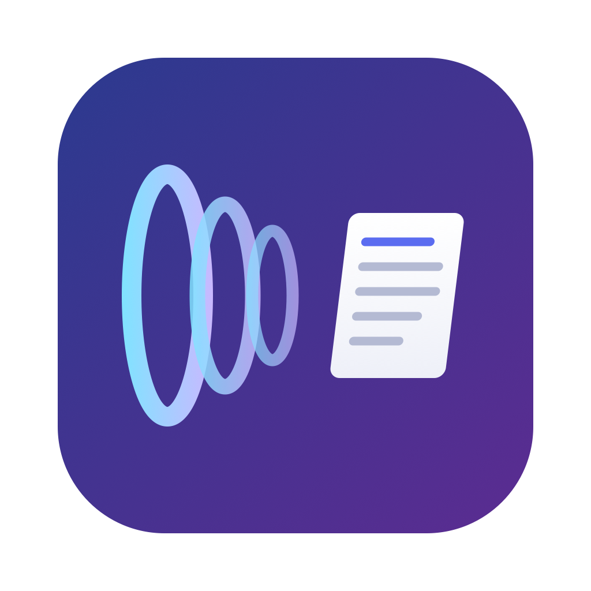

<div align="center">



# WaveScribe 声波转存

**Mac 上的本地语音转文字工具，为普通话和中英混说优化**

按一下快捷键说话，文字直接出现在光标处。识别全部在本机完成，免费、开源，小内存、快响应。

[](../../releases/latest)


[](LICENSE)

[安装](#安装) · [使用](#使用) · [和商业产品比较](#和商业产品比较) · [内存与速度](#内存与速度) · [从源码编译](#从源码编译开发者)

</div>

<!-- 截图：菜单栏图标、录音浮窗、历史窗口 -->

WaveScribe 是一个 macOS 菜单栏上的语音输入（听写）工具，默认用阿里的千问 3 ASR 模型，适合以普通话为主、偶尔夹几个英文词的口语；全英文时可以切换到 Whisper。

- **简单**：下载、拖进"应用程序"、授权两次，就能用。
- **快**：边说边转，停止录音后通常 1 到 2 秒出字；闲置后第一次用要先加载模型，会多等 1 秒左右。
- **省内存**：只在用的时候加载模型，闲置 1 分钟就释放。

想了解模型怎么选、怎么配置才能又快又省内存，见[实验记录](docs/实验记录.md)。

## 功能

- **快捷键语音输入**：默认 ⌥ 空格 开始，再按一次结束；录音中按 Esc 取消。快捷键可在偏好设置里改成别的组合键，也可以只用一个修饰键（比如单独按一下 ⌥）；还可以改成"按住说话，松开结束"。
- **直接输入到光标处**：通过辅助功能接口插入文字，不占用剪贴板；插入失败时改为粘贴，并在之后恢复原来的剪贴板内容。没有可输入的位置时，弹出小窗显示文字，可一键复制。
- **录音浮窗**：录音时显示浮窗，转写时显示一只每秒敲一下的木鱼（可在偏好设置里换成普通的转圈）。麦克风没有声音时，大约 1 秒内会提示。
- **边说边转**：在你说话的停顿处切段，前面的段落在你继续说话时就开始转写。停止录音后，通常 1 到 2 秒出字。
- **历史记录**：窗口里列出最近 24 小时的每次听写，可以直接编辑。你的修改会生成词汇表或替换规则的建议，也可以用保存的录音重新转写，比较改动前后的错误数。
- **两个识别模型可选**：默认千问 3 ASR，适合中文和中英混说；全英文听写可以切换到 Whisper。

## 安装

**系统要求**：Apple Silicon（M 系列芯片）的 Mac，macOS 15 或更新。

1. 到 [Releases](../../releases) 下载最新的 `WaveScribe.zip`，解压后把 WaveScribe 拖进"应用程序"文件夹。
2. 打开 WaveScribe。它没有 Dock 图标，只在屏幕右上角的菜单栏里显示一个麦克风图标。
3. 按提示授予两个权限：
   - **麦克风**：用来录音。
   - **辅助功能**：用来把文字直接输入到光标处，以及识别单独按下的 ⌥ 这类快捷键。WaveScribe 只用它做这两件事，代码都在本仓库里可查。不开也能用：⌥ 空格 这类组合键照常工作，只是文字会显示在小窗里，需要你自己复制粘贴。如果没有弹出提示，请到"系统设置 → 隐私与安全性 → 辅助功能"里手动打开 WaveScribe。
4. 第一次启动会自动下载模型（约 750MB），菜单栏图标会显示下载进度。下载完成后完全离线使用。
5. 在任意可以打字的地方，按 ⌥ 空格 开始说话，再按一次结束，文字会直接出现在光标处。

> [!TIP]
> 如果单独按 ⌥ 这类快捷键没有反应，多半是辅助功能权限没开，或者更新后失效了。到"系统设置 → 隐私与安全性 → 辅助功能"里把 WaveScribe 关掉再打开即可。

**更新**：WaveScribe 每天自动检查一次更新，有新版本时会弹窗提示，点一下就能安装并重启；也可以在菜单栏图标里点"检查更新…"。历史记录和设置会保留。

**卸载**：删除"应用程序"里的 WaveScribe，再删除 `~/Library/Application Support/WaveScribe`（里面是模型和历史记录）。

## 使用

- **偏好设置**（菜单栏图标 → 偏好设置）：
  - **快捷键**：可以是组合键（至少一个修饰键），也可以单独按一下 ⌃ ⌥ ⇧ ⌘ 中的一个；F1 到 F12 可以单独使用。
  - **触发方式**：按一下开始、再按一下结束，或者按住说话、松开结束。
  - **识别模型**：千问（中文、中英混说）或 Whisper（全英文）。
  - **录音保留**：见下文"数据与隐私"。
- **词汇表**：`vocabulary.txt`，每行一个词。转写时会提示给模型，适合专业术语和人名。也可以在历史记录里修改文字后，从建议里添加。
- **替换规则**：`rules.json`，在历史记录里修改文字后生成，用于固定纠正某个反复出现的错误。

## 和商业产品比较

Wispr Flow 这类商业语音输入产品做得很好：识别准，出字快，还有润色句子、整理格式等很多功能。

WaveScribe 做的是同一件事，但更精简，只做最核心的语音转文字：想说就说，转得快，转得准。它免费、开源，识别在你的电脑上完成，内存占用也小。

## 内存与速度

以下数据在 M3、16GB 内存上测得：

| 组件 | 硬盘占用 | 运行时内存 | 停止录音后的等待 |
|---|---|---|---|
| 千问 3 ASR 0.6B，4-bit（默认） | 约 680 MB | 峰值约 1 GB（speech-swift 给出的数字） | 约 0.2 到 0.9 秒 |
| Whisper large-v3 turbo（全英文选项） | 约 1.5 GB | 未单独测量 | 约 2.5 到 3.5 秒 |
| CT-Transformer 标点模型 | 约 75 MB | 很小 | 20 到 80 秒的语音约 10 到 20 毫秒 |

节省内存的做法：

- **一次只加载一个识别模型**：用哪个加载哪个，切换时先卸掉旧的。
- **用时才加载**：按下快捷键就开始从硬盘读模型（约 2 秒），和你说话同时进行。说得很短时，第一次出字会多等 1 秒左右；之后通常 1 到 2 秒出字。
- **闲置 1 分钟后卸载**：只是从内存清掉，硬盘上的模型文件不动，不需要重新下载。

## 从源码编译（开发者）

除了"安装"里的系统要求，还需要 Xcode 16 或更新，并装好 Metal 编译器。

```sh
# 第一次编译前，安装 Xcode 的 Metal 编译器（约 800 MB）
xcodebuild -downloadComponent MetalToolchain

./build.sh            # 编译并签名，在当前目录生成 WaveScribe.app
./build.sh install    # 同时复制到"应用程序"文件夹并启动
```

- **依赖下载**：第一次编译时，SwiftPM 会下载依赖，build.sh 会把 sherpa-onnx 运行库下载到 `Vendor/`。之后的编译只需几十秒。
- **签名**：默认用钥匙串里的第一个 Apple Development 证书；没有证书时用临时签名。可用 `SIGN_IDENTITY` 指定证书。证书保持不变，重新编译后就不用重新授权麦克风和辅助功能。
- **Bundle ID**：可用 `BUNDLE_ID` 设成你自己的。
- **模型下载**：第一次启动时自动下载，之后离线使用。
  - 千问 3 ASR（[aufklarer/Qwen3-ASR-0.6B-MLX-4bit](https://huggingface.co/aufklarer/Qwen3-ASR-0.6B-MLX-4bit)，来自 Hugging Face）
  - 标点模型（来自 sherpa-onnx 的 GitHub Releases）
  - Whisper：只有切换到全英文模式时才下载。

测试模式和调试用的环境变量见[实验记录](docs/实验记录.md#开发与测试)。

## 数据与隐私

- **只在本机处理**：录音、转写和后处理都在本机完成。只有下载模型时才联网（Hugging Face、GitHub）。
- **数据位置**：
  - 历史记录、录音、词汇表和规则在 `~/Library/Application Support/WaveScribe/Data`。
  - 模型在 `~/Library/Application Support/WaveScribe/models`。
- **历史记录**：只显示最近 24 小时。
- **录音保留**：超过 24 小时的录音，按偏好设置里的选项处理。
  - **只保留改过的（默认）**：你修改过文字的录音会留下，作为测试答案，用来比较模型；其余删除。
  - **全部保留**：录音和转写记录都不删。
  - **24 小时后全部删除**：和历史记录一起删掉。

## 致谢

| 项目 | 用途 | 许可 |
|---|---|---|
| [Qwen3-ASR](https://github.com/QwenLM)（阿里通义千问团队） | 默认识别模型 | Apache 2.0 |
| [speech-swift](https://github.com/soniqo/speech-swift) | 千问 3 ASR 的 Swift / MLX 实现 | Apache 2.0 |
| [MLX Swift](https://github.com/ml-explore/mlx-swift) | Apple Silicon 上的推理框架 | MIT |
| [WhisperKit](https://github.com/argmaxinc/WhisperKit) | Whisper 的 Core ML 实现 | MIT |
| [FluidAudio](https://github.com/FluidInference/FluidAudio) | Silero VAD 停顿检测 | Apache 2.0 |
| [sherpa-onnx](https://github.com/k2-fsa/sherpa-onnx) | 标点模型运行库 | Apache 2.0 |
| [Sparkle](https://github.com/sparkle-project/Sparkle) | 应用内自动更新 | MIT |
| CT-Transformer 标点模型（[FunASR](https://github.com/modelscope/FunASR)） | 中英文标点 | 见 FunASR 的模型许可 |

实验中还用过 SenseVoice、Paraformer（同样来自 FunASR）和 Qwen3 语言模型，最终没有采用。

## 许可证

本项目以 [MIT 许可证](LICENSE) 开源，© 2026 ZJ-Gao。用到的模型和第三方库各有自己的许可，见上方"致谢"。
